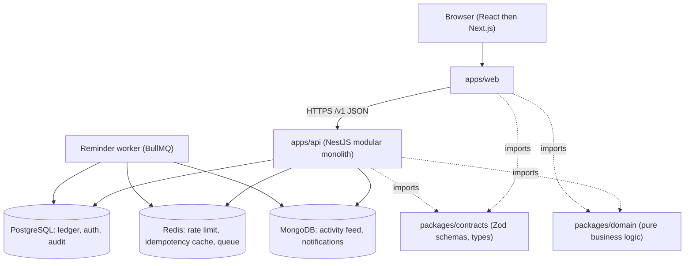
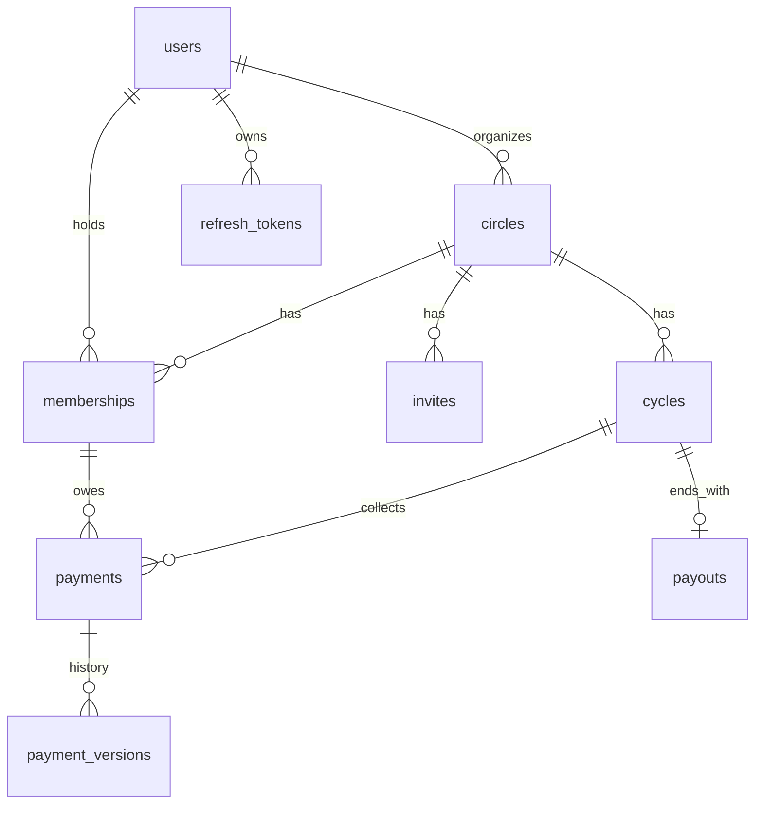

# Gam3iya: Technical specification

Version 1.0. Date: 21 October 2026. Status: proposed.
Related: [PRD](PRD.md), [SRS](SRS.md), [ADR index](adr/README.md), [Technical plan](../plan/technical-plan.md).

This document covers system design, database design, API design, domain logic, security, testing, delivery, and the path to scale. Requirement identifiers (FR-, BR-, NFR-) refer to the SRS.

## 1. Architecture overview

A pnpm monorepo with one web client, one API, and shared packages. The design is a **modular monolith**: one deployable API with clear module boundaries. Microservices would add operational cost with no benefit at this scale (ADR-004).



Phase availability: weeks 1 to 4 use a mock API (MSW) instead of `apps/api`; MongoDB, Redis, and the worker arrive in phase 4.

### 1.1 Repository layout

```
gam3iya/
  apps/web/          React (Vite) in phase 1, Next.js App Router from week 9
  apps/api/          NestJS: modules auth, circles, members, cycles, payments, payouts, audit, notifications
  packages/contracts/  Zod schemas and inferred TypeScript types shared by web and API
  packages/domain/   Pure functions: money, schedule, payment status, payout rules
  docs/              PRD, SRS, this specification, ADRs
  plan/              Technical plan and calibration log
  .github/workflows/ CI and CD pipelines
```

### 1.2 Module boundaries (API)

| Module | Responsibility | Depends on |
| --- | --- | --- |
| auth | Registration, login, tokens, sessions | users |
| circles | Circle lifecycle, activation, schedule generation | domain, audit |
| members | Invitations, joining, payout order | circles |
| payments | State machine, idempotency, corrections | domain, audit |
| payouts | Payout recording and completion | payments |
| audit | Append-only audit writer and reader | none |
| notifications | In-app notifications, reminder jobs | queue, mongo |

Dependency rule: a module talks to another only through its exported service; controllers never call repositories directly (layered: controller, service, repository).

## 2. Technology choices

| Concern | Choice | Reason |
| --- | --- | --- |
| Language | TypeScript (strict) everywhere | One language to master; shared contracts |
| Web phase 1 to 2 | React 19 with Vite, React Router, TanStack Query, React Hook Form, Zod | Revises her existing React; fast feedback |
| Web phase 3 on | Next.js App Router | Server rendering, SEO for public pages, path to full-stack |
| API | NestJS | Modules, dependency injection, guards; the concepts transfer to .NET clean architecture |
| ORM | Prisma with migrations | Typed client, readable migrations |
| Primary database | PostgreSQL 17 or 18 | ACID transactions, constraints, mature tooling |
| Cache, rate limit, queue | Redis with BullMQ | Standard, simple |
| Document store | MongoDB | Flexible event payloads for the activity feed; a deliberate learning choice (ADR-006) |
| Testing | Vitest, Testing Library, Supertest, Playwright, k6 | Unit, component, API, end-to-end, load |
| CI/CD | GitHub Actions | Required learning goal |
| Containers | Docker and Docker Compose | Local parity |

## 3. Database design (PostgreSQL)

### 3.1 Entity relationships



### 3.2 Tables

Types: `uuid` primary keys unless stated; all timestamps are `timestamptz`; all amounts are `integer` piasters.

| Table | Key columns and constraints |
| --- | --- |
| `users` | `id`, `email` (citext, unique), `password_hash`, `display_name`, `locale` (`ar` or `en`), `status`, `created_at` |
| `refresh_tokens` | `id`, `user_id` fk, `family_id`, `token_hash` (unique), `expires_at`, `revoked_at`, `replaced_by` |
| `circles` | `id`, `organizer_id` fk, `name`, `contribution_piasters` check > 0, `member_count` check between 2 and 30, `cycle_length` enum (weekly, biweekly, monthly), `start_date` date, `grace_days` smallint check between 0 and 7, `payout_order_method` enum, `status` enum (draft, active, completed, cancelled), `draw_commitment` text null, `created_at`, `activated_at` |
| `memberships` | `id`, `circle_id` fk, `user_id` fk, `payout_position` smallint null, `joined_at`; unique (`circle_id`, `user_id`); unique (`circle_id`, `payout_position`) |
| `invites` | `id`, `circle_id` fk, `token_hash` (unique), `expires_at`, `max_uses`, `used_count`, `created_by` fk |
| `cycles` | `id`, `circle_id` fk, `cycle_number` smallint, `due_date` date, `recipient_membership_id` fk, `status` enum (open, completed); unique (`circle_id`, `cycle_number`) |
| `payments` | `id`, `cycle_id` fk, `membership_id` fk, `amount_piasters` check > 0, `status` enum (pending, marked_paid, confirmed), `marked_at`, `confirmed_at`, `confirmed_by` fk null, `note`, `version` int; unique (`cycle_id`, `membership_id`) |
| `payment_versions` | `payment_id` fk, `version`, `snapshot` jsonb, `reason`, `changed_by`, `changed_at`; primary key (`payment_id`, `version`); append-only |
| `payouts` | `id`, `cycle_id` fk unique, `amount_piasters`, `paid_out_on` date, `recorded_by` fk, `override_reason` text null |
| `idempotency_receipts` | `id`, `user_id`, `key`, `payload_hash`, `response_status`, `response_body` jsonb, `created_at`; unique (`user_id`, `key`) |
| `audit_events` | `id` bigserial, `occurred_at`, `actor_id`, `action`, `entity_type`, `entity_id`, `before` jsonb, `after` jsonb, `reason`, `request_id`, `flags` text[]; INSERT-only grant |

A rejected payment is not a status: reject writes an audit event and a payment version, then sets the payment back to `pending` (BR-05). LATE is derived (FR-PAY-06) and has no column.

### 3.3 Indexes (each justified, verified with EXPLAIN ANALYZE in week 8)

| Index | Query it serves |
| --- | --- |
| `payments (cycle_id, status)` | Organizer cycle view and counts |
| `payments (membership_id)` | Member dashboard |
| `cycles (circle_id, due_date)` | Upcoming due dates, reminder job |
| `memberships (user_id)` | "My circles" list |
| `circles (organizer_id, status)` | Organizer's circles |
| `audit_events (entity_type, entity_id, occurred_at desc)` | Audit trail screen |
| `refresh_tokens (user_id)` | Logout everywhere |

### 3.4 Database roles

- `app_rw`: SELECT, INSERT, UPDATE, DELETE on business tables; **INSERT and SELECT only** on `audit_events` and `payment_versions`.
- `migrator`: schema changes; used only by the migration step.
- `readonly`: reporting and support.

### 3.5 Document store (MongoDB, phase 4)

Collection `activity_events`: `{ _id, circleId, type, actorId, payload, createdAt }` with index (`circleId`, `createdAt` desc). The `payload` shape varies per event type, which is why a document store is used here. Collection `notifications`: `{ _id, userId, type, circleId, payload, createdAt, readAt }` with index (`userId`, `readAt`, `createdAt` desc). Events are written after the PostgreSQL transaction commits, through an outbox table (`outbox_events`) so a crash between commit and write cannot lose them (ADR-007).

### 3.6 Redis (phase 4)

| Key pattern | Purpose | TTL |
| --- | --- | --- |
| `rl:{route}:{userId or ip}` | Rate limiting | Window length |
| `idem:{userId}:{key}` | Fast idempotency lookup in front of the database receipt | 24 hours |
| BullMQ queue `reminders` | Due-soon and late reminder jobs | Job-defined |

## 4. API design

Base path `/v1`. JSON. Resource-oriented URIs. Authentication by `Authorization: Bearer <access token>`; the refresh token lives in an httpOnly cookie. Naming: camelCase JSON. Collections use cursor pagination (`?cursor=&limit=`, default 20, maximum 100) and return `{ data, pagination: { nextCursor, hasMore } }`.

### 4.1 Endpoints

| Method and path | Role | Purpose | Requirement |
| --- | --- | --- | --- |
| `POST /auth/register` | public | Create account | FR-AUTH-01 |
| `POST /auth/login` | public | Issue tokens | FR-AUTH-03 |
| `POST /auth/refresh` | cookie | Rotate refresh, new access token | FR-AUTH-03, 04 |
| `POST /auth/logout` | user | Revoke family | FR-AUTH-05 |
| `GET /me`, `PATCH /me` | user | Profile and locale | FR-AUTH-06 |
| `POST /circles` | user | Create draft | FR-CIR-01 |
| `GET /circles` | user | My circles (paginated) | FR-DASH-01 |
| `GET /circles/{id}` | member | Circle detail | FR-DASH-01 |
| `PATCH /circles/{id}` | organizer | Edit draft | FR-CIR-02 |
| `POST /circles/{id}/invites` | organizer | Create invite link | FR-MEM-01 |
| `POST /invites/{token}/accept` | user | Join draft circle | FR-MEM-02 |
| `PUT /circles/{id}/payout-order` | organizer | Arrange or draw order | FR-MEM-03, 04 |
| `POST /circles/{id}/activate` | organizer | Activate, generate schedule | FR-CIR-03, 04 |
| `POST /circles/{id}/cancel` | organizer | Cancel with reason | FR-CIR-05 |
| `GET /circles/{id}/cycles` | member | Schedule with derived statuses | FR-DASH-02 |
| `POST /payments/{id}/mark-paid` | member (owner) | Mark own payment | FR-PAY-02 |
| `POST /payments/{id}/confirm` | organizer | Confirm | FR-PAY-03 |
| `POST /payments/{id}/reject` | organizer | Reject with reason | FR-PAY-03 |
| `POST /payments/{id}/record` | organizer | Record on behalf | FR-PAY-04 |
| `POST /payments/{id}/corrections` | organizer | Versioned correction | FR-PAY-07 |
| `POST /cycles/{id}/payout` | organizer | Record payout | FR-OUT-01 to 04 |
| `GET /circles/{id}/audit` | organizer | Audit trail | FR-AUD-03 |
| `GET /me/notifications`, `POST /me/notifications/{id}/read` | user | Notifications | FR-NOT-01, 02 |
| `GET /health`, `GET /ready` | public | Liveness, readiness | NFR-OBS-01 |

Write endpoints for payments and payouts require the header `Idempotency-Key` (FR-PAY-05).

### 4.2 Error model (RFC 7807)

All errors use the problem details format (RFC 7807, updated by RFC 9457 with the same shape) and `Content-Type: application/problem+json`, with `type`, `title`, `status`, `detail`, `instance`, and `errors[]` for field errors.

| Status | `type` (suffix of `https://gam3iya.example/errors/`) | When |
| --- | --- | --- |
| 401 | `unauthenticated` | Missing or invalid token |
| 403 | `forbidden` | Known resource, role not allowed |
| 404 | `not-found` | Missing resource, **or** a resource outside the caller's scope (BR-07) |
| 409 | `invalid-transition` | Payment or circle state does not allow the action |
| 409 | `idempotency-conflict` | Same key with a different payload |
| 422 | `validation-error` | Schema validation failed |
| 429 | `rate-limited` | Rate limit exceeded; `Retry-After` header |

### 4.3 Versioning and evolution

Breaking changes create `/v2`; `/v1` is supported for at least 6 months after announcement. Additive changes (new optional fields) do not bump the version. An OpenAPI 3.1 document is generated from the NestJS decorators, linted in CI, and published as a build artifact.

## 5. Domain logic (`packages/domain`)

All functions are pure (no I/O, no clock access: `today` is a parameter) so they are easy to test.

### 5.1 Money

```ts
type Piasters = number & { readonly brand: 'Piasters' };
const toPiasters = (n: number): Piasters => {
  if (!Number.isInteger(n) || n <= 0) throw new Error('amount must be a positive integer');
  return n as Piasters;
};
const formatEgp = (p: Piasters, locale: 'ar' | 'en') =>
  new Intl.NumberFormat(locale === 'ar' ? 'ar-EG' : 'en-EG', { style: 'currency', currency: 'EGP' }).format(p / 100);
```

### 5.2 Schedule generation (BR-03, BR-04)

```ts
function dueDate(start: Date, length: 'weekly' | 'biweekly' | 'monthly', k: number): Date {
  if (length === 'monthly') {
    const target = addMonths(start, k - 1);          // from start, never chained
    return clampToMonthEnd(target, start.getDate()); // 31 Jan -> 28 Feb -> 31 Mar
  }
  return addDays(start, (k - 1) * (length === 'weekly' ? 7 : 14));
}
```

### 5.3 Payment status view (FR-PAY-06)

```ts
function paymentView(p: Payment, cycle: Cycle, graceDays: number, todayCairo: string) {
  if (p.status === 'confirmed') return 'confirmed';
  const lateFrom = addDaysIso(cycle.dueDate, graceDays + 1);
  const isLate = todayCairo >= lateFrom;
  return isLate ? 'late' : p.status; // 'pending' | 'marked_paid'
}
```

### 5.4 Payout rule (FR-OUT-01 to 03)

`canRecordPayout(cycle, payments)` returns `{ ok: true }` when all payments are confirmed; otherwise `{ ok: false, requiresReason: true }`. A second payout fails at the database through the unique constraint on `payouts.cycle_id`, and the service converts it into `invalid-transition`.

## 6. Key flows

### 6.1 Mark a payment as paid (idempotent, audited)

1. Controller validates the body and the `Idempotency-Key` header with the shared schema.
2. Service opens a database transaction.
3. It looks up the receipt for (`userId`, `key`): if found with the same payload hash, return the stored response; if the hash differs, return `idempotency-conflict`.
4. It loads the payment through the **scoped repository** (only payments in circles where the caller is a member; ownership checked for the specific membership).
5. It applies the transition using the domain state machine (BR-05); an invalid transition returns `invalid-transition`.
6. It writes the payment update, a `payment_versions` row, an `audit_events` row, an outbox row, and the idempotency receipt, then commits.
7. After commit, the outbox publisher writes the activity event and notification to MongoDB (phase 4).

### 6.2 Activate a circle

Single transaction: verify member count equals `member_count`; if `RANDOM_DRAW`, draw positions with `crypto.randomInt`, store `sha256(seed + positions)` as `draw_commitment` and reveal the seed in the audit event after activation; generate N cycles with due dates and recipients; create N x N payments; set status `active`; write audit.

## 7. Security design

| Threat | Control |
| --- | --- |
| Credential theft | argon2id hashing; rate limiting on login; generic login error messages |
| Token theft | Short access token; rotating refresh token in httpOnly Secure SameSite cookie; reuse detection revokes the family |
| Broken access control | Scoped repositories (no query without caller scope); guards per role; a generated role by endpoint test matrix; out-of-scope returns 404 |
| Injection | Parameterized queries through Prisma; no raw SQL with string concatenation; schema validation on every input |
| XSS | React escaping; no `dangerouslySetInnerHTML`; strict Content-Security-Policy in Next.js |
| CSRF | SameSite cookies; refresh endpoint requires a custom header; no cookie-authenticated state-changing endpoint other than refresh |
| Tampering with amounts | Server computes all amounts and statuses; client values are ignored |
| Replay and double submit | Idempotency keys and database unique constraints |
| Data exposure | Minimal data collected; no sensitive data in logs; HTTPS only; secrets in environment variables |
| Dependency risk | Dependabot, `npm audit` in CI, pinned lockfile |

## 8. Testing strategy

| Level | Tool | Scope | Gate |
| --- | --- | --- | --- |
| Unit | Vitest | `packages/domain` and pure helpers; PRD Appendix A examples written first | 90% coverage on domain |
| Component | Testing Library | Forms, tables, status badges, RTL rendering | Critical components |
| API integration | Supertest with a real PostgreSQL test database (Docker) | Endpoints, transactions, idempotency, scope | 70% coverage on API |
| Authorization matrix | Generated tests | Every role against every endpoint | 100% of endpoints |
| End to end | Playwright | Create circle, invite, activate, pay, confirm, payout | At least 1 flow, 3 by week 16 |
| Load | k6 | Read and write mix on 10,000 payments | p95 targets in NFR-PERF-01 |
| Accessibility | axe in Playwright, Lighthouse | P0 screens | No serious violations |

Test-first rule: each acceptance check in the PRD becomes a failing test before the feature is implemented.

## 9. Delivery

### 9.1 Environments

| Environment | Purpose | Deploy trigger |
| --- | --- | --- |
| Local | Docker Compose: PostgreSQL, Redis, MongoDB | Manual |
| Preview | One per pull request (web), seeded database branch or schema | Pull request opened or updated |
| Staging | Latest `main` | Merge to `main` |
| Production | Released version | Manual approval of a tagged release |

### 9.2 CI pipeline (GitHub Actions)

On every pull request: install with cache, lint, typecheck, unit tests, API integration tests (service containers), build, OpenAPI lint, `npm audit`, then deploy a preview. `main` is protected: required checks, at least one review, linear history. Releases use tags and a generated changelog. Dependabot opens weekly update pull requests.

### 9.3 Observability

Structured JSON logs with a request id; `/health` and `/ready`; error tracking (for example Sentry free tier); basic latency and error-rate dashboard from the hosting provider. No personal or financial payloads in logs.

### 9.4 Backups

Daily automated database backup with 7-day retention; one documented restore drill in week 12.

## 10. Path to scale (input to the week 15 system design document)

| Bottleneck | First response | Later response |
| --- | --- | --- |
| Read load on dashboards | Indexes, cursor pagination, Redis caching of circle summaries | Read replicas |
| Reminder volume | Queue with concurrency control and batching | Partitioned queues, separate worker deployment |
| Audit table growth | Partition by month | Archive cold partitions |
| Single region latency | CDN for the web app | Multi-region read replicas |
| Team growth | Module boundaries and contracts package | Extract the notification module first (it already runs through a queue) |

## 11. Open technical questions

1. Prisma versus Drizzle: decided by a one-day spike in week 6 against the same acceptance tests (ADR-002).
2. Hand-built authentication versus a library such as Better Auth: build by hand in week 7 to learn the mechanics, then record a comparison in ADR-005; production recommendation is a vetted library.
3. Hosting: choose in week 11 based on free-tier limits at that time and record in ADR-008.
